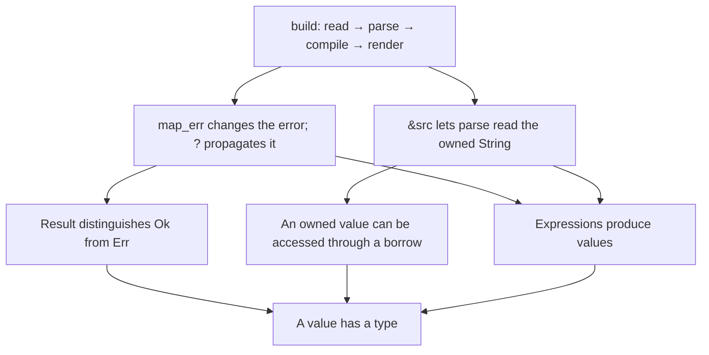

# Proposed lesson contract

A lesson opens on a complete, consequential function. Ask what it does, then
follow links from its code to the rules that explain it. Follow a rule's links
when that rule needs explanation. Multiple parents can reuse one concept node.
The direction is **thing being explained → explanation it depends on**.
It is an explanation DAG, not a schedule of chapters or the program's call graph.

For example, beatcode's `build` can lead to both borrowing and error propagation:



This sketch shows the shape; it is not a complete lesson. For example, `Result`
must lead to explanations of variants and their payloads, and `&src` needs the
relevant `String`/`str` conversion explained. One shared node must be rendered
as one concept with multiple incoming links, not copied into separate lessons.

## Data model for the first implementation

Each tutorial will provide `dag/course.json`. The small JSON contract is
independent of a particular UI. Every node contains its teaching text and a
local `page` path, relative to that tutorial, for its eventual Markdown page.
The page must include its payload and explicit links to its dependency pages.
No graph library, hosting, or site redesign is required by these tests.

```json
{
  "schema_version": 1,
  "language": "python",
  "goal": "implement-debug-explain-evals",
  "roots": ["py.score-ticket"],
  "nodes": [
    {
      "id": "py.score-ticket",
      "kind": "function",
      "level": 3,
      "title": "Score one support-ticket extraction",
      "page": "dag/nodes/score-ticket.md",
      "payload": "def score_ticket(prediction, reference):\n    ...",
      "explanation": "Explain the behavior and why this scoring policy matters.",
      "context": "support-ticket-eval",
      "depends_on": [
        {
          "id": "py.key-sets",
          "anchor": "prediction",
          "why": "Explain how comparing key sets prevents missing or extra fields."
        }
      ],
      "assessment": {
        "mode": "implement",
        "prompt": "Implement the scorer and defend one rejected output.",
        "success": "Pass behavior tests and explain the schema and value checks."
      }
    }
  ],
  "coverage": {"scoring": ["py.score-ticket"]}
}
```

This deliberately incomplete example illustrates fields; it must fail the
acceptance suite because its dependency and the rest of its coverage are absent.
Use executable code instead of `...` in the authored course.

- `kind` is `function`, `rule`, `expression`, or `primitive`.
- `level` is a nonnegative abstraction rank. Every edge strictly decreases it;
  ranks need not be consecutive. It is not difficulty or lesson order.
- Function payloads are full functions, including the signature and body.
  Rule/expression payloads show the specific expression or rule being taught.
- Each edge names the child, quotes an `anchor` in the parent's payload, and
  explains `why` that dependency helps. Merely listing related topics fails review.
- Every node has one question and an observable success criterion. Roots use
  `implement`, `debug`, or `adapt` in Python; `trace`, `predict`, `explain`, or
  `change-impact` in Rust. Other nodes may also use `explain` or `predict`.
- Leaves must be `primitive`, have level zero, no outgoing edges, and a
  `stop_reason`. For example: “An identifier names a binding; this course assumes
  the reader can recognize written names.” An unexplained `Result`, closure,
  iterator, JSON object, or borrowing rule is not a suitable primitive.
- No dangling edges, duplicate IDs/edges, cycles, orphan nodes, or unreachable
  coverage. Each root must reach a rule, then a lower rule/expression, then a
  primitive. Each course must demonstrate shared dependencies.
- Python roots use context `support-ticket-eval`, `grader-validation`,
  `eval-data`, `eval-analysis`, `eval-runner`, or `agent-traces`.
- Rust function nodes identify `source_id` in the beatcode lock and include the
  exact pinned function as their payload. Rule nodes can quote subexpressions.
  The initial roots cover `build`, `compile`, `num_token`, `events_jsonl`,
  `time_offset`, and `render`. These exercise actual repo reading, not writing
  a replacement music compiler. Extend the source lock when adding functions.

`coverage` maps the following capability names to actual reachable nodes.
Automated coverage is a traceability check; human review must verify the claim.

| Python: fluent implementation | Rust: explain beatcode |
|---|---|
| functions-collections | pipeline-navigation |
| mutation-and-records | ownership-borrowing |
| files-jsonl-validation | option-result-errors |
| scoring | enums-patterns |
| grader-validation | generics-traits |
| error-accounting | collections-iterators |
| reproducibility | numeric-determinism |
| paired-analysis | tests-and-spec |
| bounded-concurrency-retries | change-impact |
| agent-traces | |

The first Python executable assessments cover scoring, ingestion, and error
accounting. Later assessments must cover the other rows before the full course
is accepted. No claim of full skill coverage follows from the first three tasks.

## Human acceptance tests

1. **Start at the function.** Without prereading a chapter, can the learner
   identify its input, output, role, and one meaningful failure case?
2. **Explain this code.** Pick an unfamiliar expression in the payload. A link
   must explain that expression in context, including implicit behavior such
   as coercion, mutation, error propagation, or helper-function preconditions.
   Check all consequential syntax/helper calls, not just the annotated sample.
3. **Keep descending.** Follow every unfamiliar rule until the stated baseline.
   If a leaf still requires an unexplained language concept, add dependencies.
   Foundational assumptions are visible and can be expanded after an attempt.
4. **One concept per node.** A rule node answers one specific question, supplies
   a concrete example, and states relevant preconditions or limits. A chapter
   hidden inside a node fails. Shortness alone does not establish modularity.
5. **Navigate a DAG.** Follow two branches to the same shared concept and back
   to either parent. Links work locally. The current function and breadcrumb
   remain clear. Reading order never forces already-understood foundations.
6. **Respect the domain.** Python examples preserve measurement meaning: missing
   samples, false passes/failures, split leakage, and retry accounting remain
   visible. Rust claims trace to pinned beatcode code/spec/tests; explain what
   the implementation does even when it surprises a generic Rust expectation.
7. **Separate comprehension from authorship.** Python requires fresh code,
   debugging, and a changed requirement. Rust requires source navigation,
   accurate predictions, and explanations with evidence. Rust authorship is
   optional and never a required readiness gate.
8. **Measure the learner.** Give a fresh variant before revealing the key. Keep
   the attempt, assistance, evidence, and next action. Use introduced / assisted /
   independently demonstrated / needs review. Recheck after an intervening
   session. Green generated code or opened pages do not establish mastery.

Do not auto-grade prose by keywords or fabricate learner attempts. A reviewer
must record concrete evidence and remaining gaps; all learner statuses start
unassessed. This contract is a reviewable first design, not a claim that a DAG
by itself establishes better learning.
